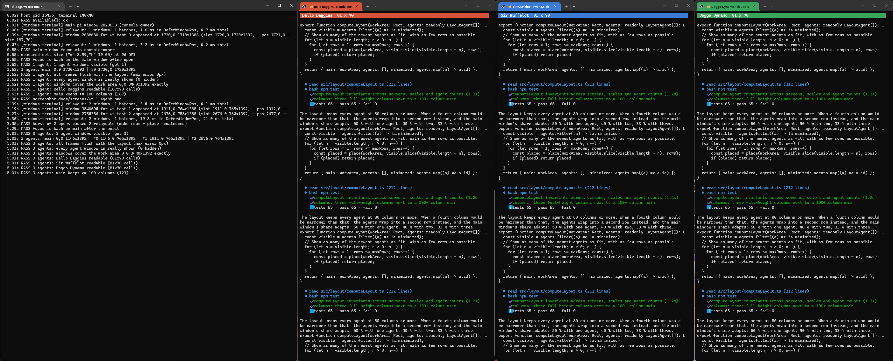

# Windows Terminal window backend

`src/backend/windows-terminal/` implements `PaneBackend` (`src/backend/pane-backend.ts`) with **one Windows Terminal (WT) window per agent**. The windows are tiled next to the main pi window through Win32. This is "approach B" from the layout spike (`docs/spike/layout.md`, PLAN §13 and §15).

All numbers below were measured on Windows 11 Pro 26200 with WT 1.24.11911, Node 24.19, one 3440 × 1440 monitor at 100 % (96 DPI), over RDP. They come from the probes described here and from `npm run test:wt`.

| Screenshot | State |
|---|---|
| [`wt-1-agent.png`](screens/wt-1-agent.png) | 1 agent: 50 / 50, both 187 × 70 cells |
| [`wt-3-agents-columns.png`](screens/wt-3-agents-columns.png) | 3 agents: main 33 % (123 cols), agents 81 × 70 |
| [`wt-4-agents-grid.png`](screens/wt-4-agents-grid.png) | 4 agents: 2 × 2 grid, main 40 % (149 cols), agents 110 × 33 |
| [`wt-5-after-close.png`](screens/wt-5-after-close.png) | the user closed one agent, and the rest re-tiled to 3 columns |
| [`wt-6-minimized.png`](screens/wt-6-minimized.png) / [`wt-7-restored.png`](screens/wt-7-restored.png) | minimize, then restore into the slot without taking the focus |

## Files

| File | Purpose |
|---|---|
| `win32.ts` | koffi bindings, loaded lazily on first use. Only the small `Win32` interface is used elsewhere, so tests can use a fake. |
| `wt-args.ts` | builds the `wt.exe` argv: escaping, validation (pure) |
| `geometry.ts` | frame insets, `--pos`/`--size` from a rect, cell size estimate, animation frames (pure) |
| `scheduler.ts` | coalesces relayout bursts (pure, injectable clock) |
| `main-window.ts` | finds the WT window that hosts pi |
| `launch.ts` | titles, finding `wt.exe`, running it, discovering the new HWND |
| `tiler.ts` | ordered window set → `computeLayout` → one `DeferWindowPos` batch; polls for changes |
| `backend.ts` | `WindowsTerminalBackend`: glues everything together |

## How it works

### Layout (`src/layout/computeLayout.ts`)

This is the rule measured in the spike (PLAN §15), as a pure function:

1. Main stays on the left of its monitor's work area and always gets at least `mainMinCols` (100) columns.
2. `"columns"` (default): as many **full-height** agent columns as fit with at least `agentMinCols` (80) columns each. Beyond that, the agents form **two rows of columns** (at least `agentMinRows` = 16 rows each). Beyond that, the **oldest agents are auto-minimized**. `"stacked"` (one column of equal heights, then a second column) is still available.
3. Main's share adapts to the number of agent columns *k*: `2 / (k + 3)`, which gives 50 % / 40 % / 33 % / 29 %. These are exactly the most readable shares the spike measured. Seen as weights, main is as wide as one column when there is one agent, and grows towards twice a column's width when there are many. The hard minimums always win over this preference. `mainFraction` can be set to a fixed number instead.
4. `secondaryWorkAreas` (other monitors) take agents that do not fit next to main. This happens **before** any area adds a second row, and before anything is minimized. The newest agents stay next to main. Each secondary area can carry its own cell size (for a different DPI).
5. **Small or highly scaled screens** (`relaxPrefs`): if not even one agent fits next to main, the minimums are relaxed step by step before anything is minimized. First main may shrink to `agentMinCols`. If that is still too wide, main and the agent column split the area 50 / 50, as long as each half keeps at least `RELAXED_MIN_COLS` (60) columns. Rows (up to `maxRows`) then work as usual. Below 60 columns per half, the agents are minimized. The same applies to a secondary area that is too narrow for one `agentMinCols` window.
6. The rects are integers and tile every work area exactly.

On 3440 × 1392 this gives: 1 agent → main 1720 / agent 1720. 2 → 1376 / 1032 + 1032. 3 → 1146 / 765 + 765 + 764 (81 cols each). 4 → 2 × 2 grid, main 1376. 5–6 → 3 + 2 or 3 + 3 grid, main 1146. 7 and more → the oldest agents are minimized. On 1920 px only one full-height column fits next to a 100-column main, so the second agent already goes into a second row (or onto a second monitor).

Smaller or scaled screens (default font, cells from the DPI; cols × rows per window, work area = screen minus a 48 px taskbar):

| Work area | 1 agent | 2 agents | 3+ agents |
|---|---|---|---|
| 1366 × 728 @ 100 % (50 / 50) | main 71, agent 71 × 35 | main 71, agents 71 × 16 in 2 rows | 2 shown, oldest minimized |
| 1920 × 1032 @ 100 % | main 102, agent 102 × 51 | main 102, agents 102 × 24 in 2 rows | 2 shown |
| 1920 × 1032 @ 125 % (main ≥ 80) | main 83, agent 83 × 40 | main 83, agents 83 × 18 in 2 rows | 2 shown |
| 1920 × 1032 @ 150 % (50 / 50) | main 64, agent 64 × 32 | 1 shown | 1 shown |
| 2560 × 1392 @ 150 % (main ≥ 80) | main 87, agent 87 × 45 | main 87, agents 87 × 21 in 2 rows | 2 shown |
| 2880 × 1752 @ 200 % (50 / 50) | main 76, agent 76 × 43 | main 76, agents 76 × 20 in 2 rows | 2 shown |

Before this relaxation, every one of these screens except 1920 @ 100 % minimized all agents.

### Launching a window (`open`)

1. **Reserve the slot and make room.** The agent is added to the tiler (without an HWND yet), and a relayout runs. Main and the existing agents move right away, so an empty slot appears where the new window will show up. Opens that arrive together are coalesced into one relayout (30 ms quiet time, at most 200 ms). So every window of a burst already knows its final slot.
2. **Launch in place.**
   `wt -w pi-dogs-<agentId>-<nonce> --pos X,Y --size C,R new-tab --title "🐕 <name> · <model><tag>" --suppressApplicationTitle --tabColor #rrggbb -d <cwd> -- <command> <args…>`
   - Measured in WT 1.24: `--pos x,y` puts the visible frame at `(x − 1, y)`. `--size c,r` gives a frame of `c · 9 + 35` × `r · 19 + 58` px. With the slot rect, the window appears within 1–9 px of its final size (for example 1718 × 1388 for a 1720 × 1392 slot). The final correction is therefore barely visible.
   - The nonce in the window name makes sure we never reuse a named window left over from an earlier session. `wt` would add a tab to such a window instead of creating a new one.
   - `<tag>` is 8 invisible characters (U+200B/C/D, U+2060). They make the title unique even if two pi sessions both spawn "Bello Baggins". They are not visible in the tab or the taskbar (see the screenshots).
3. **Discover the HWND.** Before launching, we take a snapshot of all `CASCADIA_HOSTING_WINDOW_CLASS` windows. Then we poll `EnumWindows` every 15 ms for a *new* WT window with exactly our title that is **visible**. WT creates its window hidden, sets the title, and shows the window about 20–30 ms later.
   - **Captions without the tab title** (for example `showTerminalTitleInTitlebar: false`): if exactly one new, visible WT window has appeared within 48 px of the `--pos` spot and stays unmatched for `discoveryFallbackMs` (1000 ms), it is accepted, and this is logged. A WT window the user opens elsewhere at the same time is never taken.
   - **Given up** (timeout, the agent was closed meanwhile, or dispose): we keep looking for the window with our exact title in the background for another `discoveryTimeoutMs` and send it `WM_CLOSE` when it shows up, so no orphan window stays behind.
   - **wt.exe failed**: it is retried once, but only if no window with our title (not even a hidden one) has appeared 250 ms later. Otherwise the retry would start the agent twice.
4. **Give the focus back.** Every new WT window takes the foreground. We restore it to the window that had it before the launch, usually main. We also do this when the foreground belongs to another window of the same burst. If the user has moved to some other window in the meantime, we leave the focus alone. `SetForegroundWindow` from the pi process (a console process inside WT) is allowed. No `AttachThreadInput` or ALT-key trick is needed, and none is used. If Windows' foreground lock refuses it anyway (most likely when the previous window was not a WT window), this is logged and the optional `onFocusNotReturned(ref)` event is emitted, so the hub can tell the user that keystrokes now go to the agent window. The focus is then left where it is.
5. **Place it exactly**, in the same coalesced relayout.

### Finding the main window

`GetConsoleWindow()` in a WT tab returns ConPTY's hidden `PseudoConsoleWindow`, and that window is **owned** by the WT top-level window. So `GetAncestor(console, GA_ROOTOWNER)` gives exactly the window that hosts pi (verified in WT 1.24). This does not depend on focus, on titles, or on how many WT windows are open. Titles are never used, because pi and the user can change them.

There is deliberately **no fallback**. An earlier version used the foreground WT window if WT_SESSION was set, but WT_SESSION is inherited by conhost and VS Code terminals started from a WT tab, and the backend starts lazily at the first `open()`, so that could resize any window of the user. If main is not found, no window except our own agent windows is ever moved. The main area of the layout then simply stays empty (the agents do not stretch over it).

The lookup costs three calls, so the tiler repeats it on every poll and relayout. If the pi tab is torn out into another WT window (or dragged into one), the tiler follows it: the old window gets its original frame back, and the new one is tiled.

### Tiling (`Tiler.apply`)

- It computes the layout for the monitor that main is on (`MonitorFromWindow` + `GetMonitorInfoW.rcWork`). The prefs are scaled by `GetDpiForWindow(main) / 96`. Other monitors (`EnumDisplayMonitors`, their DPI via `GetDpiForMonitor`) become secondary areas, nearest first.
- **Cell size:** before main is resized for the first time, it is measured from main's DWM frame and pi's terminal size (`process.stdout` columns and rows): `(frame − chrome) / cells`. Here this measured 8.99 × 19.05 px. If the numbers do not fit (more than 40 % away from the DPI estimate, for example because pi runs in a split pane), the DPI-scaled default 9 × 19 is used instead. `prefs.cellSize` from the config overrides both.
- It shows or minimizes windows first, with `ShowWindowAsync`, and waits up to 150 ms until the requests took effect. Restore uses `SW_SHOWNOACTIVATE` (no focus change). Minimize uses `SW_SHOWMINNOACTIVE` (the active window stays active). Maximized agent windows are un-maximized the same way before they are placed.
- **Hung windows** (`IsHungAppWindow`) are skipped entirely: no show, no placement. A frozen WT window therefore cannot freeze pi. Captions are read with `InternalGetWindowText`, which sends no message either.
- Then it places **main and all visible agents in one `BeginDeferWindowPos`/`EndDeferWindowPos` batch**, with `SWP_NOZORDER | SWP_NOACTIVATE | SWP_NOOWNERZORDER` and never `SWP_NOREDRAW`. Rects are visible frames. The invisible borders (7/0/7/7 px at 96 DPI) are measured for each window (`GetWindowRect` compared with `DWMWA_EXTENDED_FRAME_BOUNDS`) and added. Windows that are already at their target are skipped, so a no-op relayout makes no terminal reflow. If the batch fails, every window is placed with its own `SetWindowPos`, and this is logged.
- It reads the frames back afterwards. Windows that are off get one corrective batch. This is meant for a window that crossed to a monitor with a different DPI and rescaled itself. Because WT rescales asynchronously, windows whose DPI changed are read back and corrected once more about 100 ms later.
- A maximized main window is restored (`SW_SHOWNOACTIVATE`) before it is tiled. When no agent is visible any more, main gets back its original frame. If main was maximized before, it gets the full work area instead, because re-maximizing would activate it. If main is on another monitor by then, the frame is moved (and scaled for the DPI) onto that monitor's work area.
- `dispose()` (pi quits) gives main its original frame back right away with one `SetWindowPos`, because the pending relayout is cancelled.

### Watching for changes (poll every 250 ms)

These checks cost well under 1 ms per tick:
- `IsWindow`: the user closed the window, or its process exited. The backend emits `onClosed` and re-tiles.
- `IsIconic` differs from what we set: the user minimized or restored the window from the taskbar. The backend emits `onMinimizedChange(ref, minimized, "user")`. A window the user restores that would not fit where it was becomes the newest one, and the oldest agent yields.
- Changes to the monitor, work area or DPI (main moved to another monitor, resolution changed, taskbar resized): the backend re-tiles once the change has been **stable for 500 ms**, and not while the user is dragging main (its thread is in a move/size loop, `GetGUIThreadInfo` → `GUI_INMOVESIZE`, or the left mouse button is down). So dragging main across monitors is not fought over; the re-tile happens when it is dropped.
- The main window lookup (see above), to follow a torn-out tab.
- A poll that fails (for example no monitor during an RDP reconnect) still reports the windows that were closed.

### Contract change

`BackendEvents` gained two **optional** events:
- `onMinimizedChange?(ref, minimized, reason: "auto" | "user")`. Auto-minimizing is a decision the backend makes, and without this event the hub could not keep its agent list and mirror view in sync. It is emitted only for effective changes (an auto-minimized window that is then minimized explicitly produces no event).
- `onFocusNotReturned?(ref)`: a new agent window kept the foreground (see *Give the focus back*).

The change is purely additive. Nothing else in `PaneBackend` changed.

### Configuration

`new WindowsTerminalBackend(options)` accepts the following:
- `prefs`: any `LayoutPrefs` override (`arrangement`, `mainMinCols`, `agentMinCols`, `agentMinRows`, `mainFraction`, `maxRows`, `maxColumns`, `gap`, `cellSize`, `chrome`).
- `useSecondaryMonitors` (default `true`; it only matters when agents would otherwise be minimized).
- `animation` (default `false`, see below).
- `discoveryTimeoutMs` (8000), `discoveryFallbackMs` (1000), `pollIntervalMs` (250), `relayoutDelayMs` (30), `relayoutMaxDelayMs` (200).
- `log`.

## Measurements

| What | Result |
|---|---|
| koffi + bindings load (once) | 60 ms here (the spike measured 21–28 ms for fewer bindings) |
| `wt.exe` runtime | 108–140 ms |
| New window visible after spawn | 216–239 ms (probe); `open()` end to end, including make-room relayout, discovery, focus and placement: **370–680 ms** |
| Burst of 2 opens | 920–1090 ms for both. That was 2–3 relayouts: one to make room, then one per window, because they appear 100–300 ms apart |
| One relayout (up to 5 windows) | 1.2–7.7 ms inside `DeferWindowPos`, 2–21 ms in total. Once it took 228 ms, while WT was busy creating another window at the same moment (`EndDeferWindowPos` waits for WT's UI thread) |
| Flush tiling | **0 px error** in every checked state (1, 3, 4 agents, after close, minimized, restored, after `close()`) |
| Focus | always back on main after `open()`, after a burst, and after `restore()` |
| User closes a window → re-tiled | 268–556 ms: WT removes the window about 240 ms after the process exits, plus the 250 ms poll |
| `close()` (WM_CLOSE) | 62–78 ms |
| Readability on 3440 × 1392 | main 187 / 123 / 149 cols with 1 / 3 / 4 agents. Agents 187 × 70, 81 × 70, 110 × 33 |

### Animation: measured, and off by default

The tiler can ease between layouts (`animation: { durationMs, frames }`, ease-out cubic). It interpolates edges, not sizes, so neighbouring windows never show a gap. `test:wt` compares a single step with 6 frames over 150 ms on 3 windows, toggling between 1 and 2 visible agents (4 transitions each):

| | Wall time | Time in `DeferWindowPos` | Terminal reflows per transition |
|---|---|---|---|
| Single step | 5–11 ms | 2.2–4.9 ms | **1** |
| 6 frames / 150 ms | 170–244 ms | 15–88 ms (up to about 15 ms per frame) | **1–6** |

Every animation frame resizes every terminal. WT reflows the text each time, and the application inside (pi redraws its whole TUI; the spike measured up to 300 ms until pi had redrawn) repaints at a size that is already outdated. Frames also miss their 25 ms budget whenever WT is busy. The single step changes all windows in one composed frame, and each terminal reflows once. So **single step is the default**. It looks calmer and settles about 160 ms sooner. The option stays in place for experiments, for example with a move-only transition.

## Pitfalls found while building this (all handled)

- **`spawn(..., { windowsHide: true })` makes the WT window invisible forever.** It puts `SW_HIDE` into STARTUPINFO, and WT applies that to the window it creates. Our windows existed, had their titles and were tiled, but were never shown. A visibility check in the test caught this.
- **`fs.existsSync` returns false for `wt.exe`.** The app execution alias in `%LOCALAPPDATA%\Microsoft\WindowsApps` is a reparse point that `stat` cannot follow. Use `lstat`.
- **`;` anywhere in any argument splits the wt command line**, not only a bare `;`. Every `;` is escaped as `\;`, and wt removes exactly one backslash.
- **wt re-joins the child arguments** and quotes only elements that contain a space, without escaping. We pre-quote each argument with MSVCRT rules and strip the outer quotes where wt adds them. Verified end to end with 20 nasty arguments: spaces, quotes, trailing backslashes, `;`, tabs, empty strings, emoji, `^&|`.
- **wt expands `%NAME%`** in the command line and the starting directory, and there is no escape. `buildWtArgs` rejects such values. Pass them in the launch file instead.
- **WM_CLOSE does close a WT window**, even while its process is still running. The window was gone after 40–60 ms, and the process was ended by WT. The spike's note that WM_CLOSE is ignored did not reproduce.
- **koffi 3.3 anonymous types** can get the same generated name, for example a struct and a later proto, which breaks pointer declarations. We use named types with a per-load suffix, which also avoids collisions with other koffi users in the pi process.
- **Timers:** the relayout timer must not be `unref()`ed. Callers `await` it, and a process with nothing else alive would exit in the middle of that await. The 250 ms poll *is* `unref()`ed.
- **Node on Windows reports console resizes only while it reads stdin.** pi does read stdin. The test's dummy agents do too, and they also poll `getWindowSize()`.
- **`PrintWindow` returns black for inactive WT windows** (WT renders through DirectComposition). The test screenshots therefore raise our windows (without activating them) and copy the screen, but **only inside our own frames**. Before saving, 49 sample points per window are checked with `WindowFromPoint`, and the screenshot is not saved if anything else is on top. So no other window of the user can end up in `docs/screens/`.

## Limitations

- **Tested on one monitor at 100 % only.** The multi-monitor layout math, the DPI scaling of cells, chrome and insets, and the corrective second placement after DPI changes are unit-tested but **not verified on hardware**. Please run `npm run test:wt` on a 125 % / 150 % machine and on a multi-monitor setup. The launch offset (`--pos x+1`) is scaled by DPI as a guess.
- **Focus is stolen for a moment** on every new window: from its appearance until our poll notices it, that is 15–30 ms. Keystrokes typed exactly in that window go to the new agent.
- The user's own windows can cover the tiles. We never force the z-order.
- We do not fight the user. If the user moves or resizes a tiled window by hand, it stays like that until the next relayout (agent opened, closed, minimized or restored, or monitor changed).
- An agent window in WT's own full screen mode (F11) is not taken out of it; maximized windows are.
- The cell size is measured from the main tab. If the main tab is zoomed (Ctrl + =) or uses another profile or font than new windows, set `prefs.cellSize`.
- Each agent window has its own tab row, about 2 rows fewer than a pane. Focus mode would win those rows back but hides the coloured, named tab, so we do not use it.

## Troubleshooting

| Symptom | Check |
|---|---|
| `available()` says WT_SESSION is not set | Start pi from a Windows Terminal tab (not conhost, VS Code or ssh). |
| "wt.exe was not found" | Settings → Apps → Advanced app settings → App execution aliases: enable *Terminal*. Or `winget install Microsoft.WindowsTerminal`. |
| "cannot load the Win32 bindings (koffi)" | `npm install` in the pi-dogs package. koffi ships prebuilt binaries and needs no install script. |
| "did not appear within 8000 ms" | Look for a WT error dialog (for example an invalid profile). Check that `wt -w test new-tab` works in a shell. Raise `discoveryTimeoutMs` on slow machines. |
| Main window is not tiled | The debug log line `main pi window … (source)` says `none` when pi is not attached to a WT console (for example pi runs in conhost or VS Code started from a WT tab). Main is then left alone on purpose, and its area stays empty. |
| Windows are a few pixels off or overlap after a DPI change | Run `backend.relayout()`. Please report the numbers from `backend.diagnostics()`. |
| Focus stays in a new agent window | Windows' foreground lock refused `SetForegroundWindow`. It is logged as "could not give the focus back". |

## Tests

- `npm test` runs the unit tests for this backend: `test/unit/computeLayout.test.ts`, `wt-args`, `wt-geometry`, `wt-scheduler`, `wt-launch`, `wt-tiler` and `wt-backend`, with a fake window manager in `test/helpers/fake-win32.ts`.
- `npm run test:wt` is the integration test and is not part of `npm test`. It opens a dedicated WT window that plays the main pi window, so your own terminal is never touched. In it, the test opens up to 4 dummy agents through the real backend (`pwsh -Command` with `;`, quotes and paths with spaces). It checks every frame against the layout to the pixel, checks visibility, focus and readable cell counts, simulates a user closing one agent, minimizes and restores, runs the animation measurement, saves screenshots to `docs/screens/`, and closes everything it opened. It touches only windows it created. Runtime is about 20 s.
